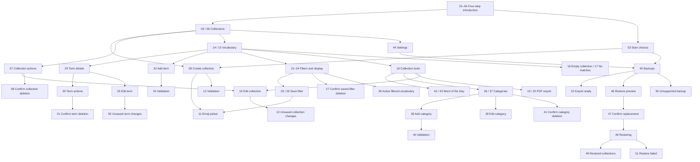

# Vocabulaire — Screen and interaction map

This handoff describes a complete design proposal. The native application has not been modified. Screen numbers identify matching light and dark appearances in the review gallery and Stitch project.

## Navigation

## Every view and representative state

| Screens | Workflow | Coverage |
| --- | --- | --- |
| 01–04, 53 | Onboarding | Four distinct pages, progress, rightward advance gesture, Back/Next/Skip, create/restore shortcuts |
| 05–08 | Collections | Populated home, welcoming empty home, edit/delete actions, destructive confirmation |
| 09–13 | Collection form | Create, edit, reusable emoji picker, required-name validation, unsaved-change guard |
| 14–20, 28 | Vocabulary | Compact and detailed lists, no terms, no matches, tool menu, current-results PDF export, export ready, active saved filter |
| 21–27 | Filters and display | Grouped category selection, all sort fields/directions, density, saved populated/empty, save/validation, delete confirmation |
| 29–35 | Terms | Details, edit/delete menu, deletion confirmation, add, edit, required-field validation, unsaved-change guard |
| 36–41 | Categories | Grouped list, empty state, create, edit, validation, delete confirmation |
| 42–43 | Word of the Day | Daily word and insufficient-terms state |
| 44 | Settings | System/English/Español and System/Light/Dark, backups |
| 45–52 | Data portability | Backup home/export, selected-file counts, explicit replacement confirmation, progress, success, invalid-file/failure recovery |

All 53 states have matching light and dark designs. Native Android file picking and sharing are system-owned transitions; their destination lists are not invented in the app design.

## Interaction contracts

- **Introduction:** swipe right advances, left returns. Next and Back do the same. Skip completes onboarding and opens home. Create starts the collection draft; Restore opens Backups.
- **Root navigation:** no redundant bottom tabs. Settings is accessible from home. Every pushed screen has a Back action. Opening a modal or sheet contains focus; Back dismisses it.
- **Save:** validate on submit and after correcting an invalid field. Keep entered values, announce the error, and focus the first invalid field. Commit once; disable repeat saves while committing. Return to the invoking screen and announce success.
- **Collection fields:** ask only for the required name and emoji. The legacy alias and migrated short-label field are retired from the proposed UI; collection rows show name, emoji and term count.
- **Term fields:** expression, translation, optional notes and categories. Do not imply a separate pronunciation or phonetic-transcription feature in either functional screens or illustrations.
- **Dirty forms:** back/close prompts Keep editing / Discard changes only after a real change. The emoji picker and category editor return to the preserved draft. Canceling a sub-editor preserves its caller's draft.
- **Categories:** multi-select in term forms and filters. Grammar/thematic types have names and icons, not only color. Type is fixed after category creation. Category deletion removes assignments, not the terms.
- **Search:** case-insensitive, matching original expression, translation, and notes. Diacritic-insensitive for Latin scripts. Query text is always visible; search reset is explicit.
- **Filtering:** OR within a category type, AND between types, combined with search. Filter sheets edit a draft; Apply commits, Close/Back cancels pending changes. Clear category filters leaves the search and display preferences intact.
- **Sort:** original and translation offer A–Z/Z–A. Last updated offers oldest/newest. The list summary states the active choice. Display preferences are independent of saved filters.
- **Saved filters:** contain search and category selection, plus a name and emoji. Apply immediately updates search/categories. A changed selection ceases to display the saved-filter Applied badge. Deleting a filter keeps all vocabulary.
- **Term deletion from list:** a row's overflow opens the same term actions and confirmation shown in 30–31. Row content remains a large details target. No permanently exposed red delete buttons.
- **Word of the Day:** one stable daily pick from the current collection, available at five terms. No shuffle or learning score. Open term routes to the existing details view.
- **PDF:** the current matching results, current order, and current density determine the document. Show that scope before creation, without a page preview or document thumbnail. Generating and handoff failures remain on the sheet with Retry; do not show Ready until generation succeeds. Native chooser cancellation returns without an error.
- **Backups:** file selection and validation happen before preview. The preview shows collection/term/category/filter counts and replacement consequences. Only the final Replace all data action begins replacement. Do not claim merge or legacy compatibility. Export-current-first is optional.
- **Restore:** prevent duplicate operations. Success returns to home with a concise result announcement. Validation and restore failures preserve existing data and offer recovery. Never claim data was kept if the platform cannot guarantee atomic rollback.
- **Language and appearance:** persist immediately, no save button. UI language does not constrain vocabulary language. System settings follow the device. All copy needs English/Spanish equivalents and room for expansion.

## Accessibility and delivery checks

- Reading order follows the visible hierarchy. TalkBack names emoji/icon controls and announces selected chips, radio options, errors, and result changes without reading decorative illustrations.
- Touch targets are at least 48 dp, text scales, and fixed action bars clear both the gesture area and keyboard. Long words, notes, and collection names wrap.
- App assets and fonts should be bundled; all collection, filtering, daily-word, export, and restore operations work without a network connection.
- The designs demonstrate representative states; persistent errors, selection controls, keyboard behavior, and theme adaptation still require validation in the native implementation.
